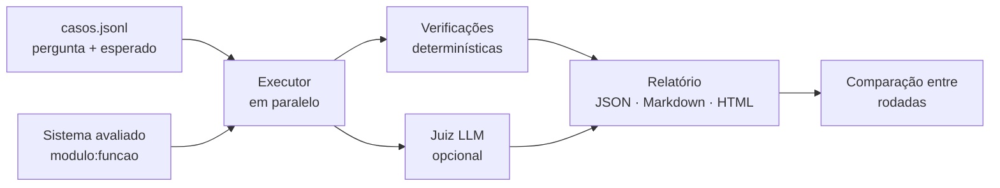

# avaliador-llm

Ferramenta para **medir a qualidade de sistemas que usam IA** (assistentes, chatbots, agentes), do mesmo jeito que testes automáticos medem um código comum.

Com IA, "funcionou quando eu testei" não basta: uma mudança no prompt, no modelo ou na busca pode melhorar uma resposta e piorar outras dez sem ninguém perceber. O avaliador roda um conjunto fixo de perguntas, confere cada resposta, gera um relatório e **compara rodadas para achar regressões** (o que passava e passou a falhar).

```text
$ avaliador comparar resultados/exemplo-antes.json resultados/exemplo-depois.json

# Comparação 📈 53% → 67%
**Regressões (passava, agora falha):** nenhum
**Melhorias:** recusa-01, recusa-02
```

## Como funciona



**1. Casos em JSONL**: um caso por linha, fácil de editar e de revisar no Git:

```json
{"id": "spoiler-01", "pergunta": "Qual é o nome completo da Ayla?",
 "contexto": {"assistiu_ate": "xdq-05"},
 "esperado": {"nao_deve_conter": ["Navarro"]}, "tags": ["spoiler"]}
```

| Campo de `esperado` | O que verifica |
|---|---|
| `deve_conter` | A resposta menciona estes termos (sem diferenciar acento e maiúscula; `"123\|cento e vinte e três"` aceita qualquer opção). Dá nota parcial. |
| `nao_deve_conter` | A resposta **não** menciona estes termos (spoiler, informação errada conhecida). |
| `deve_recusar` | O sistema deve dizer que não sabe (pergunta fora do assunto). |
| `fontes_esperadas` | As fontes citadas incluem estas páginas. |
| `resposta_referencia` | Resposta ideal, usada pelo juiz LLM. |

Se o sistema "recusar" uma pergunta que tinha resposta, isso também conta como falha.

**2. Qualquer sistema pode ser avaliado**: basta uma função `(pergunta, contexto) -> resposta`, indicada no formato `modulo:funcao`. A resposta pode ser texto, dicionário ou `Saida`. Já vem pronto um adaptador para o [rag-wiki-equiverso](https://github.com/Borniotti/rag-wiki-equiverso).

**3. Juiz LLM (opcional, `--juiz`)**: o Claude lê pergunta, resposta e referência e dá notas de 1 a 5 de **fidelidade** (inventou algo?) e **utilidade** (respondeu de fato?), com justificativa, em JSON validado por esquema. Pega o que regras simples não pegam, mas custa tokens e varia um pouco entre rodadas, por isso fica desligado por padrão.

**4. Pronto para CI**: `rodar --minimo 0.8` termina com erro se a taxa de acerto ficar abaixo de 80%, e `comparar` termina com erro se houver regressão. Dá para barrar um pull request que piora o assistente.

## Exemplo real: melhorando o assistente da wiki

Rodei o avaliador contra o [rag-wiki-equiverso](https://github.com/Borniotti/rag-wiki-equiverso) (no modo só busca, sem chamar a IA) com os 15 casos de [`dados/casos-equiverso.jsonl`](dados/casos-equiverso.jsonl). A primeira rodada mostrou dois problemas:

1. **O assistente nunca dizia "não sei".** Para "Quem ganhou a Copa do Mundo de 2002?", ele devolvia um trecho qualquer que tinha a palavra "ganhou". A busca BM25 sempre encontra *alguma coisa*. A correção foi medir quanto da pergunta o melhor trecho cobre, pesando cada palavra pela raridade dela (uma palavra que não existe na wiki, como "Copa", pesa muito). Abaixo de 50% de cobertura, o assistente responde que não encontrou e nem chama a API, o que também economiza dinheiro.
2. **Um caso de teste estava errado.** O caso de spoiler sobre o Osvaldo proibia a palavra "morto", mas ela aparecia num trecho permitido sobre *outro* personagem. Corrigi o caso para usar termos específicos da cena. Avaliações também têm bugs, e o relatório detalhado ajuda a achá-los.

Resultado: **53% → 67%, sem nenhuma regressão** (relatórios em [`resultados/`](resultados/)). As falhas que sobraram são do modo sem IA, que só mostra o trecho mais bem colocado. Para ver quanto a resposta redigida pelo Claude melhora isso, basta rodar de novo com `ANTHROPIC_API_KEY` definida.

## Como rodar

```bash
pip install -e ".[dev]"

# avaliar o sistema de exemplo (devolve a própria pergunta, para ver uma nota ruim)
avaliador rodar dados/casos-equiverso.jsonl --sistema avaliador_llm.exemplos:eco

# avaliar o assistente da wiki (precisa do rag-wiki-equiverso instalado e indexado)
RAG_INDICE=../rag-wiki-equiverso/indice.json \
  avaliador rodar dados/casos-equiverso.jsonl --sistema avaliador_llm.exemplos:RagEquiverso --nome depois

# com juiz LLM e só os casos de spoiler
avaliador rodar dados/casos-equiverso.jsonl --sistema ... --juiz --tag spoiler

# comparar duas rodadas
avaliador comparar resultados/antes.json resultados/depois.json
```

Cada rodada salva `nome.json` (dados completos), `nome.md` (resumo) e `nome.html` (página para abrir no navegador).

## Testes

```bash
pytest
```

São 22 testes: leitura e validação dos casos (com mensagens de erro claras), cada verificação, execução em paralelo (ordem mantida, erro de um caso não derruba os outros), juiz LLM com cliente falso, relatórios, comparação e a linha de comando.

## Próximos passos

- Repetir cada caso N vezes e medir a variação (IA não responde sempre igual).
- Medir custo em tokens por caso e por rodada.
- Gerar casos novos a partir de conversas reais (com revisão humana).

---

Desenvolvido por Matheus Borniotti com a ajuda de IA (Claude) como par de programação.
